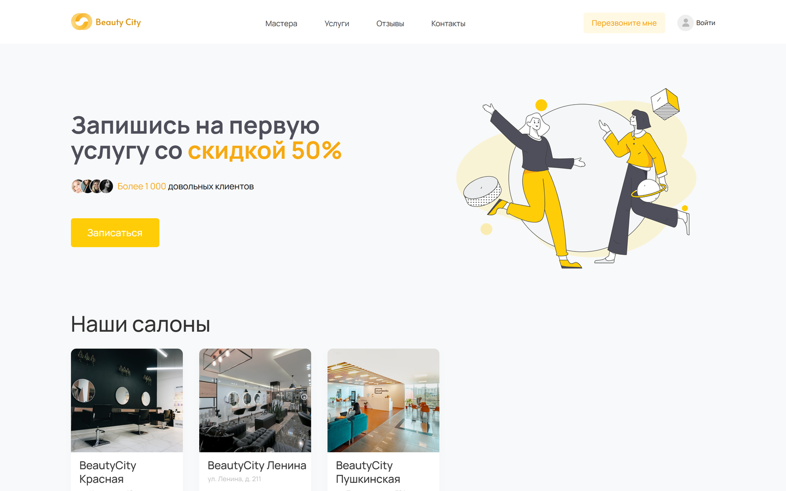
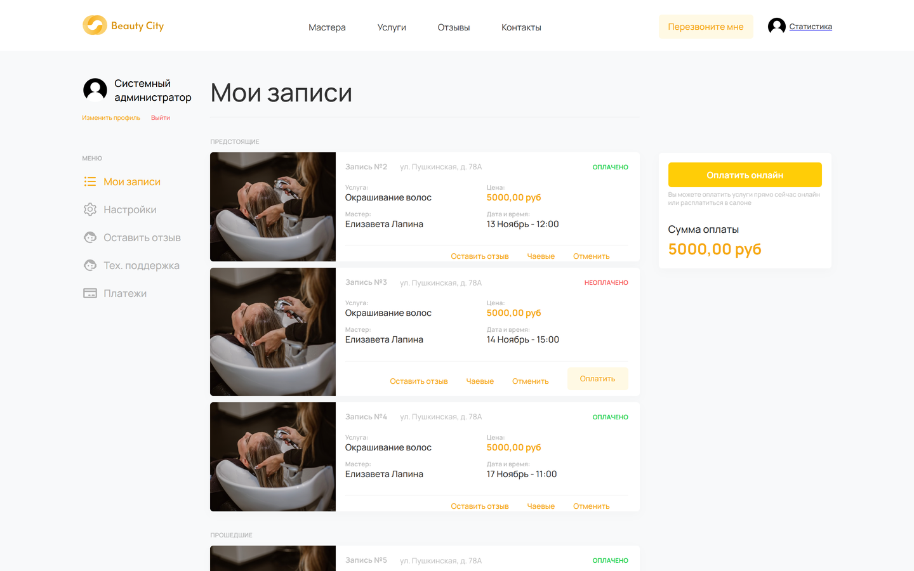
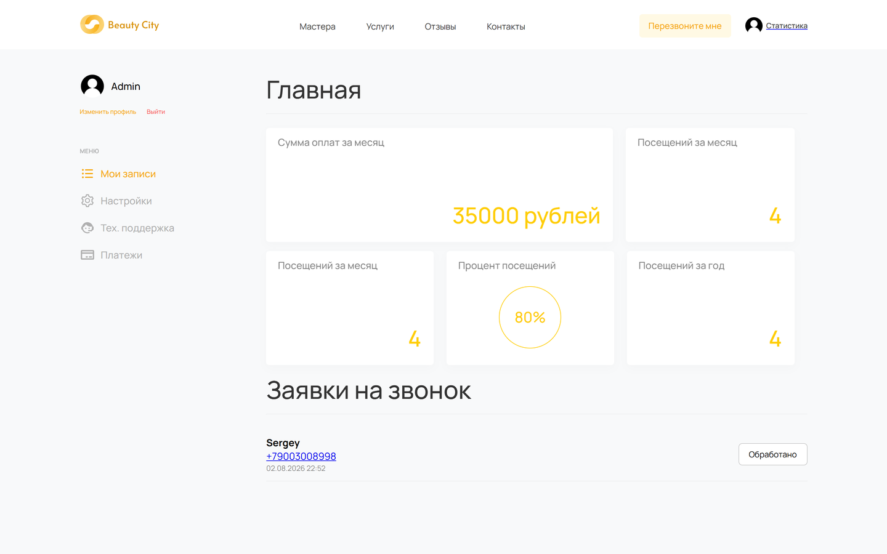
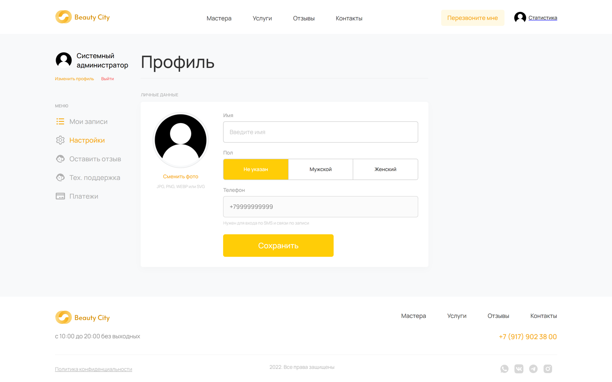

# BeautyCity

**Онлайн-запись в сеть салонов красоты: от выбора мастера до оплаты и статистики для бизнеса.**

Клиент выбирает салон, процедуру, мастера и свободное время, оплачивает визит онлайн и управляет записями в личном кабинете. Сотрудники видят записи и заявки в админке, а показатели за месяц — в отдельной панели. Без переписок, звонков и ручного сведения данных в таблицах.

[](https://beauty.kislyakov.pro/)

[](https://www.python.org/)
[](https://www.djangoproject.com/)
[](https://www.django-rest-framework.org/)
[](https://www.sqlite.org/)
[](https://yookassa.ru/)
[](https://docs.astral.sh/uv/)
[](https://docs.astral.sh/ruff/)
[](https://pre-commit.com/)
[](#-тесты)
[](.github/workflows/deploy.yml)



## ✨ Что умеет

### Для клиента

- **Запись за четыре шага** — салон → услуга → мастер → дата и время. С главной страницы можно сразу перейти к нужному мастеру, услуге или салону.
- **Только релевантные мастера** — в списке появляются специалисты, которые действительно работают в выбранном салоне и выполняют выбранную процедуру.
- **Живое расписание** — свободные слоты рассчитываются на бэкенде по сменам мастера с учётом занятых интервалов, длительности процедуры и текущего времени. Ничего не захардкожено.
- **Вход без пароля** — по номеру телефона и SMS-коду.
- **Личный кабинет** — предстоящие и прошедшие визиты, отмена записи, оплата одной или нескольких записей, чаевые мастеру, отзывы, профиль с аватаром.
- **Запись без регистрации** — гость получает доступ к своим записям через сессию, а после входа по SMS записи находятся по номеру телефона.
- **Промокоды** — скидка проверяется и применяется на сервере, а не в браузере.
- **Обратный звонок** — если клиенту удобнее, он оставляет заявку, и она попадает в панель сотрудника.

### Для бизнеса

- **Панель персонала** (`/dashboard/`) — сумма оплат за месяц, количество визитов, процент посещаемости и необработанные заявки на звонок.
- **Django-админка** — салоны, услуги, цены по салонам, мастера, смены, записи, промокоды, отзывы и согласия.
- **Разграничение доступа** — панель доступна только сотрудникам, клиентские API работают с записями текущего пользователя.

## 🖼️ Скриншоты

| Запись на услугу | Мои записи |
|---|---|
|  |  |
| **Панель персонала** | **Профиль клиента** |
|  |  |

## 🧠 Инженерные решения

**Расчёт свободных слотов.** Слоты не хранятся в базе: `apps/core/slots.py` пересекает рабочие смены мастера с активными записями, отбрасывает прошедшее время и проверяет, что процедура целиком помещается в смену. Шаг сетки — 30 минут, длительность берётся из услуги.

**Безопасная запись под нагрузкой.** Создание записи сериализуется настоящим `UPDATE` по `Specialist.booking_version`, после чего пересечение интервалов перепроверяется внутри транзакции. Дополнительно база запрещает две активные записи одного мастера на одно время (`UniqueConstraint` с условием `status != canceled`). На SQLite-блокировки предусмотрен ограниченный retry, а параллельный сценарий закрыт тестом.

**Платежи, которым можно доверять.** И вебхук, и страница возврата заново запрашивают платёж в API ЮKassa и сверяют статус, сумму и `metadata` с данными в базе. Клиентский ответ не считается доказательством оплаты. Подтверждение идемпотентно: повторный вызов не меняет уже подтверждённую запись.

**Доступ к чужим данным закрыт.** Телефоны нормализуются до единого формата. `/api/my-bookings/` требует авторизации и фильтрует по телефону пользователя. Отмена и чаевые проверяют владельца, гостевую сессию или роль сотрудника, отзывы доступны только авторизованным, а гостевой доступ ограничен идентификаторами записей в сессии.

**Валидация на границе.** DRF-сериализатор проверяет связку «салон — мастер — услуга», формат телефона, доступность слота и промокод до записи в базу. Итоговая цена и скидка считаются на сервере.

**Качество и поставка.** 64 теста покрывают запись, слоты, промокоды, оплату, права доступа и конкурентный сценарий. Ruff и pre-commit следят за стилем, GitHub Actions автоматически деплоит `main` на VPS.

## 🧰 Стек

| Слой | Технологии |
|---|---|
| Backend | Python 3.14, Django 6.1, Django REST Framework |
| База данных | SQLite (индексы, constraints, транзакции) |
| Frontend | Django Templates, jQuery, Slick, Air Datepicker, Arctic Modal |
| Платежи | ЮKassa (проверка платежей на сервере) |
| Инструменты | uv, Ruff, pre-commit |
| Инфраструктура | GitHub Actions, Gunicorn, nginx, systemd, Let's Encrypt |
| Тесты | Django TestCase / DRF APITestCase |

SQLite выбран осознанно: один VPS, небольшой объём записей и простой бэкап файла. Схема и код не привязаны к SQLite — при росте нагрузки база меняется на PostgreSQL.

## 🗂️ Структура

```text
.
├── beauty_city/                  # настройки Django, корневые URL, WSGI
├── apps/
│   └── core/                     # вся бизнес-логика
│       ├── models.py             # Salon, Procedure, Specialist, Booking, PromoCode, Review, Tip, ...
│       ├── views.py              # страницы и JSON API
│       ├── serializers.py        # валидация записи и промокодов
│       ├── slots.py              # расчёт свободных слотов и проверка пересечений
│       ├── phone_auth.py         # вход по SMS-коду, нормализация телефонов
│       ├── payment_views.py      # создание платежей и проверка оплаты ЮKassa
│       ├── admin.py
│       ├── urls.py
│       ├── tests.py              # 64 теста
│       └── management/commands/  # seed_db, generate_shifts, ensure_admin
├── templates/                    # страницы и переиспользуемые partials
├── static/                       # css, js, изображения
├── deploy/                       # nginx, systemd, первичная настройка VPS
├── .github/workflows/deploy.yml  # CI/CD
├── pyproject.toml                # зависимости и настройки Ruff
└── uv.lock                       # зафиксированные версии зависимостей
```

## 🔌 API

| Метод | Эндпоинт | Назначение |
|---|---|---|
| `GET` | `/api/salons/`, `/api/procedures/`, `/api/specialists/` | Справочники для формы записи |
| `GET` | `/api/salons/{id}/procedures/` | Услуги и цены конкретного салона |
| `GET` | `/api/salons/{id}/specialists/` | Мастера салона |
| `GET` | `/api/slots/` | Свободное время по салону, мастеру, услуге и дате |
| `POST` | `/api/bookings/` | Создание записи с проверкой слота и промокода |
| `POST` | `/api/bookings/{id}/cancel/` | Отмена своей записи |
| `GET` | `/api/my-bookings/` | Записи авторизованного клиента |
| `POST` | `/api/promo/check/` | Проверка промокода |
| `POST` | `/api/reviews/`, `/api/tips/` | Отзыв и чаевые |
| `POST` | `/api/payments/webhook/` | Вебхук ЮKassa с повторной проверкой платежа |
| `GET` | `/api/admin/stats/` | Агрегированная статистика для панели |

## 🚀 Локальный запуск

```bash
# 1. Клонировать репозиторий
git clone https://github.com/skislyakow/BeautyCity.git
cd BeautyCity

# 2. Установить uv (если ещё не установлен)
# Windows (PowerShell):
powershell -ExecutionPolicy ByPass -c "irm https://astral.sh/uv/install.ps1 | iex"
# Linux / macOS:
curl -LsSf https://astral.sh/uv/install.sh | sh

# 3. Установить зависимости — uv сам скачает Python 3.14 из .python-version
uv sync

# 4. Создать .env в корне проекта
#    DJANGO_SECRET_KEY=django-insecure-dev-key
#    DJANGO_DEBUG=True
#    DJANGO_ALLOWED_HOSTS=127.0.0.1,localhost
#    SITE_URL=http://127.0.0.1:8000
#    YOOKASSA_SHOP_ID=
#    YOOKASSA_SECRET_KEY=

# 5. Подготовить базу
uv run python manage.py migrate
uv run python manage.py seed_db
uv run python manage.py generate_shifts

# 6. Запустить
uv run python manage.py runserver
```

Сайт откроется на [http://127.0.0.1:8000/](http://127.0.0.1:8000/). `seed_db` создаёт салоны, услуги, мастеров, цены и демо-суперпользователя, `generate_shifts` — рабочие смены на ближайшие 30 дней. Без ключей ЮKassa всё работает, кроме онлайн-оплаты.

## 🧪 Тесты

```bash
uv run python manage.py test
```

64 теста: расчёт слотов, создание и отмена записей, промокоды, права доступа, платежи, отзывы, чаевые и параллельная запись на один слот.

Проверка стиля и форматирования:

```bash
uv run pre-commit install      # один раз после клонирования
uv run pre-commit run --all-files
```

## 🔑 Демо-доступ

| Что | Как войти |
|---|---|
| Django-админка: `/admin/` | `Admin` / `Admin` |
| Панель персонала: `/dashboard/` | войти по телефону `+7 (999) 999-99-99`, код `1234` |
| Личный кабинет клиента | любой номер телефона, код `1234` |

В демо-среде SMS не отправляются: код печатается в консоль сервера, а `1234` — тестовая заглушка. Для реального запуска подключается SMS-провайдер, а демо-доступ отключается.

## ☁️ Деплой

Каждый push в `main` запускает [GitHub Actions](.github/workflows/deploy.yml): workflow подключается к VPS по SSH, обновляет код, выполняет `uv sync --frozen --no-dev`, `collectstatic` и `migrate`, обновляет переменные окружения и перезапускает systemd-сервис.

Продакшен-конфигурация лежит в `deploy/`: Gunicorn за nginx, статика и медиа раздаются напрямую, SSL — Let's Encrypt. Деплой намеренно не трогает данные: `seed_db` и создание администратора выполняются только вручную.

**Прод:** [beauty.kislyakov.pro](https://beauty.kislyakov.pro/)
